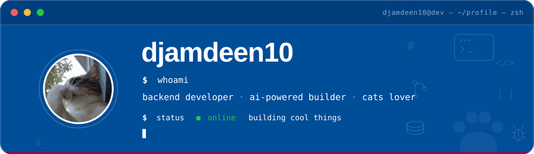

  

**[🇬🇧 English](#user-content-english)** &nbsp;·&nbsp; **[🇫🇷 Français](#user-content-francais)** &nbsp;·&nbsp; **[🇪🇸 Español](#user-content-espanol)** &nbsp;·&nbsp; **[🇸🇦 العربية](#user-content-arabic)**

  

  Hey, I'm <b>Djam Deen</b> 👋  
  Backend dev, a bit of a dreamer. I code things that are useful and cool - sometimes even pretty , and I let AI do the heavy lifting.

## 🚧 What I'm building

<table>
<tr>
<td width="62%" valign="top">

<h3>📱 AgentMob </h3>

<b>Your AI agents, orchestrated from your pocket.</b> 
Free and private.

  
  
  
  

</td>
<td width="38%" valign="top">

<h4>🎯 The idea</h4>

Make powerful AI feel as simple as sending a text message.

<h4>🧩 Status</h4>

<code>In progress</code>

</td>
</tr>
</table>

## 📦 Selected projects

<table>
<tr>
<td width="100%" valign="top">

<h4>🧪 The lab</h4>

Half-finished ideas, late-night prototypes and small tools that scratch my own itch. 
Everything that survives the night lands on my repos — go take a look. 👇

  

</td>
</tr>
</table>

<!-- ============================================================
     PINNED REPOS — décommente ce bloc quand tu as des repos publics
     et remplace REPO1 / REPO2 par leurs noms.
     ============================================================
<table>
<tr>
<td width="50%">
  
</td>
<td width="50%">
  
</td>
</tr>
</table>
-->

## 🧰 Stack

<table>
<tr>
<td valign="top" width="50%">

<h4>🧠 Languages</h4>

  
  
  
  
  
  

<h4>⚙️ Backend &amp; API</h4>

  
  
  
  

<h4>🗄️ Data</h4>

  
  

</td>
<td valign="top" width="50%">

<h4>🎨 Frontend</h4>

  
  

<h4>🤖 AI</h4>

  
  
  

<h4>🛠️ Tools</h4>

  
  

</td>
</tr>
</table>

  🎯 <b>Daily drivers</b> : <code>VS Code</code> · <code>Claude</code> / <code>DeepSeek</code> · <code>Git</code> 

## 📊 Some numbers

  
  

## 🌴 Beyond the code

- 🎧 **Music** - rap · pop · drill, on repeat
- 🐱 **Cat person** - cats, obviously. That's the face behind the commits up there.
- ⚽ **Football** - Barça through and through 🔵🔴 
- 🚀 **Mindset** - *Dream big. Work bigger.*

## 📬 Let's talk

  
  &nbsp;
  

  

  Made with ❤️

 

---

<!-- ============================================================
     🇫🇷 FRANÇAIS
     ============================================================ -->

<b>🇫🇷 Français</b> — clique pour ouvrir

 

### 👋 Salut, moi c'est Djamdeen

Dev **backend**, adepte des nuits calmes, des grosses idées et du code qui marche du premier coup.
Je construis des trucs qui réfléchissent — et j'essaie de garder le process aussi chill que possible. 🐱☕

### 🚧 Ce que je construis

**📱 AgentMob** *(privé · en cours)*
Orchestre tes agents IA depuis ton téléphone. Gratuit, privé, et entièrement à toi.
Stack : `TypeScript` · `React` · `Hono` · `PostgreSQL`

### 🧰 Stack

- **Langages** : JavaScript · TypeScript · Python · C · C++ · Java
- **Frontend** : React · Next.js
- **Backend & API** : Node.js · Hono · Laravel · FastAPI
- **Data** : PostgreSQL · SQLite
- **IA** : Claude · DeepSeek · ChatGPT
- **Outils** : Git · GitHub

### 🌴 En dehors du code

- 🎧 **Musique** : rap · pop · drill — en boucle
- 🐱 **Team chats**, évidemment
- ⚽ **Football** : Barcelonais 🔵🔴
- 📺 **Séries** : *Scorpion* · *Person of Interest* · *Chuck*
- 🚀 **Mindset** : *Rêve grand. Travaille plus grand.*

### 📬 Contact

[GitHub](https://github.com/djamdeen10) · [X](https://x.com/djamdeen10) · [djamdeen10@gmail.com](mailto:djamdeen10@gmail.com)

---

<!-- ============================================================
     🇪🇸 ESPAÑOL
     ============================================================ -->

<b>🇪🇸 Español</b> — haz clic para abrir

 

### 👋 ¡Hola, soy Djamdeen!

Desarrollador **backend**, fan de las noches tranquilas, las ideas grandes y el código que funciona a la primera.
Construyo cosas que piensan — y trato de que el proceso sea lo más chill posible. 🐱☕

### 🚧 Lo que estoy construyendo

**📱 AgentMob** *(privado · en progreso)*
Orquesta tus agentes de IA desde tu teléfono. Gratis, privado y totalmente tuyo.
Stack: `TypeScript` · `React` · `Hono` · `PostgreSQL`

### 🧰 Stack

- **Lenguajes**: JavaScript · TypeScript · Python · C · C++ · Java
- **Frontend**: React · Next.js
- **Backend y API**: Node.js · Hono · Laravel · FastAPI
- **Datos**: PostgreSQL · SQLite
- **IA**: Claude · DeepSeek · ChatGPT
- **Herramientas**: Git · GitHub

### 🌴 Fuera del código

- 🎧 **Música**: rap · pop · drill, en bucle
- 🐱 **Persona de gatos**, obviamente
- ⚽ **Fútbol**: Barça 🔵🔴
- 📺 **Series**: *Scorpion* · *Person of Interest* · *Chuck*
- 🚀 **Mentalidad**: *Sueña en grande. Trabaja aún más grande.*

### 📬 Contacto

[GitHub](https://github.com/djamdeen10) · [X](https://x.com/djamdeen10) · [djamdeen10@gmail.com](mailto:djamdeen10@gmail.com)

---

<!-- ============================================================
     🇸🇦 العربية
     ============================================================ -->

<b>🇸🇦 العربية</b> — اضغط للفتح

 

### 👋 أهلاً، أنا Djamdeen

مطوّر **backend**، أحب الليالي الهادئة والأفكار الكبيرة والكود الذي يعمل من أول محاولة.
أبني أشياء تفكّر — وأحاول أن تبقى التجربة هادئة وممتعة قدر الإمكان. 🐱☕

### 🚧 ما أبنيه حاليًا

**📱 AgentMob** *(خاص · قيد التطوير)*
نسّق وكلاء الذكاء الاصطناعي من هاتفك. مجاني، خاص، وملكك بالكامل.
التقنيات: `TypeScript` · `React` · `Hono` · `PostgreSQL`

### 🧰 التقنيات

- **اللغات**: JavaScript · TypeScript · Python · C · C++ · Java
- **الواجهة**: React · Next.js
- **الخلفية و API**: Node.js · Hono · Laravel · FastAPI
- **البيانات**: PostgreSQL · SQLite
- **الذكاء الاصطناعي**: Claude · DeepSeek · ChatGPT
- **الأدوات**: Git · GitHub

### 🌴 خارج الكود

- 🎧 **الموسيقى**: راب · بوب · درِل — على التكرار
- 🐱 **صاحب قطط**، طبعًا
- ⚽ **كرة القدم**: برشلونة 🔵🔴
- 📺 **المسلسلات**: *Scorpion* · *Person of Interest* · *Chuck*
- 🚀 **العقلية**: *احلم كبيرًا، واعمل أكبر.*

### 📬 تواصل

[GitHub](https://github.com/djamdeen10) · [X](https://x.com/djamdeen10) · [djamdeen10@gmail.com](mailto:djamdeen10@gmail.com)

